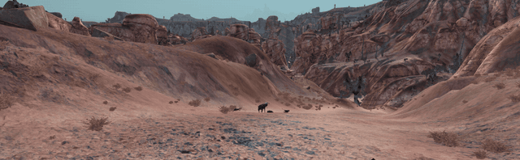
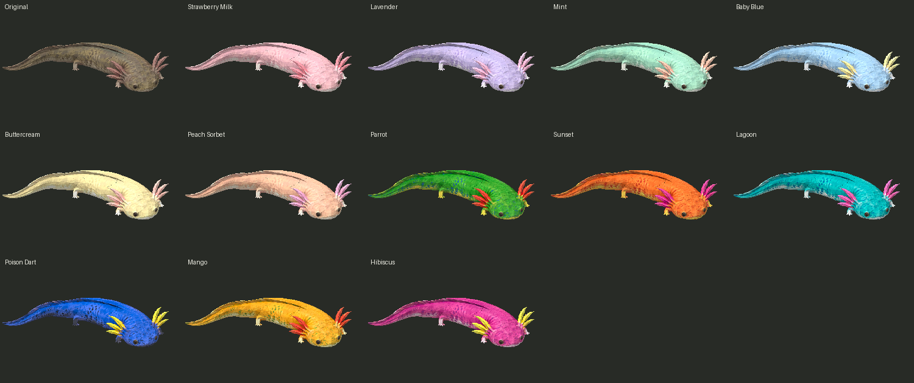
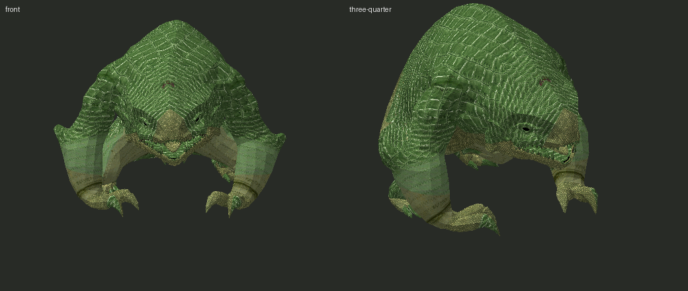

# PZA's Wildlife for Meitou

> **Version 0.10.0** (2026-11-27) · beta · code mod for [Meitou](https://github.com/VlcekM/MeitouClient) `>=0.20.1`
> (checked on 0.20.1, 0.24.0 and 0.24.1-nightly.20261127) · author: PZA · GPLv3
> Source: [Meitou-Modding-Ecosystem/PZAMeitouWildlife](https://github.com/Meitou-Modding-Ecosystem/PZAMeitouWildlife)

**Kenshi's world, a little more alive.** Birds come down to the dead. The Swamp gets fireflies, louder nights, frogs on the banks and
froxlotls that dash into the water and swim away when you come near. Everything here is drawn only: nothing touches the simulation, the AI or your
saves, so you can add or remove the mod at any time.

*Headless Meitou 0.22.1, no post-processing. Top: sped up. Bottom: real time.*

*The froxlotl's seven colours in the game (TheIvoryDisaster's model and textures), drawn from the mod's own bake.*

## Thanks

**[TheIvoryDisaster](https://github.com/TheIvoryDisaster)** made the froxlotl (model, rig and all thirteen colours) for PZA's mods. Thank you!

## What it does

### Birds at carrion

- **Carrion draws birds.** A fresh kill pulls birds from up to 3 km away, at most 6 on one body. An old body (four game hours, or once it
  has flies) pulls from 1 km, at most 2.
- **They wait for you to leave.** While anyone stands within about 35 m of the body, the birds circle overhead instead of landing.
- **Landing and pecking.** A bird brakes with quick wing beats, folds its wings as it touches down a wingspan away from the body and from
  other birds, turns to face it, then dips its head, hops (wings flicking half open) and turns. After a while it has eaten and flies off.
- **Blood while pecking.** Where a bird bites at the body, a small spray of blood: the game's own hit mist and spray, sized for a beak.
  It needs Meitou's code-mod effects (0.22.2-nightly.20261123 or newer); on older builds the birds peck without blood.
- **Flight.** Anyone (player or not, as long as they are conscious) within about 20 m of a landed or low bird makes the birds at that body
  burst up, each its own way, beating hard as they climb. They stay away for 25-50 seconds.
- **Wing beats.** Every bird in the sky beats its wings while it climbs and now and then on the level, each on its own timing. Each wing
  pose is the game's own bird model bent in memory: 16 frames for a beat, folds in steps of 5%.

### The Swamp

- **Fireflies.** At dusk and at night fireflies drift over the Swamp, blink, and light the ground around them. Rain thins them out but
  doesn't dim them.
- **Night sounds.** The Swamp's night ambience (frogs, insects) starts at dusk instead of 23:00, and its calls play a little louder.
- **Frogs.** Frogs sit at the water's edge, more at night. Come within about 7 m and they leap into the water with a splash, then come
  back later somewhere else. The frog is the game's own Gorillo shrunk to frog size, in a matte lizard skin with its own eyes and claws,
  moving with the Gorillo's own idle, walk and run.

  
- **Froxlotls.** Froxlotls (45 to 63 cm) rest at the water's edges, more at night, and crawl about now and then. Come within about 7 m
  and they turn and dash into the water with a salamander wiggle, splash in, and swim away just under the surface (legs tucked back,
  tail driving) toward deeper water before sinking out of sight. They come back later. Each visit to the
  Swamp brings four of the seven colours: the wild brown one and three of Parrot, Sunset, Lagoon, Poison Dart, Mango and Hibiscus.

### Settings

One ready-made look, nothing to tune. Settings > Mods > PZA's Wildlife has a switch for each: *Birds at carrion* (and *Blood while
pecking*), *Fireflies*, *Night sounds*, *Swamp frogs* and *Froxlotls*. English, Russian, Chinese and Japanese (the translations are
machine-drafted; corrections are welcome).

## What it doesn't touch

Meitou's birds are drawn only: they are not part of the simulation, the AI or the save. Frogs, froxlotls and fireflies are drawn
the same way. The mod writes nothing to your saves. Turning birds off hands every bird back to the game at once.

The folded wings, wing beats, the frog's model, animations and skin are made in memory from your install's own files each time the game
starts; no game file is copied, changed or shipped. Where a Meitou build lacks something the mod needs, that one piece stays off (and the
log says why) while the rest still works.

## Install

Put the `PZAWildlife` folder in Kenshi's `mods` folder and enable *PZAWildlife* in the Meitou launcher's mod list.

## Build

Clone [PZA's Meitou UI](https://github.com/Meitou-Modding-Ecosystem/PZAMeitouUi) next to this repo (the mod compiles in its string
table; its fuzz kit runs the tests), unpack a Meitou release (win-x64), and name it in `mod/local.props` (git-ignored):

    <Project><PropertyGroup><MeitouDir>C:\path\to\Meitou-0.20.1-win-x64</MeitouDir></PropertyGroup></Project>

Then:

    mod\build.ps1                build against that release and stage mod\out\PZAWildlife\
    mod\build.ps1 -Check         plus the offline check and the fuzzer (never starts the game)
    mod\build.ps1 -Check -RunOn <another Meitou release>    the same build checked on another release

The offline check reads a few of the game's files from your Kenshi install (`-KenshiDir`, read only). It covers the rules case by case,
the bird poses, the frog's animations and skin, the froxlotl's bake, and the Harmony patches applied to the real `MeitouClient.dll`
with Meitou's own bird flocks flying over a test terrain. Mutation check: `python -I ..\PZAMeitouUi\fuzz\mutate.py PZAMeitouWildlife`
(every planted bug in `tests/fuzz/mutants.txt` must be caught).

The froxlotl's walk and run are baked from TheIvoryDisaster's rigged model by `mod/tools/froxlotl/bake_froxlotl.py` (on
[PZA's Kenshi Motion Lab](https://github.com/Meitou-Modding-Ecosystem/PZAKenshiMotionLab)) into `mod/assets/froxlotl/froxlotl.pzaf`.

## How it works

The patches are all on Meitou's drawing side:

- `Birds.UpdateAttractors` (postfix): copies the bodies and the living people from the world snapshot.
- `BirdFlocks.Update` / `BirdFlocks.Step` (prefixes): a body takes free birds; a taken bird moves by the rules in `mod/src/WildCore.cs`.
- `BirdFlocks.AddPieces` (postfix) and `DebrisRenderer.Load` (prefix): every bird drawn in its wing pose (`mod/src/BirdFold.cs`), and the
  frogs (`FrogCore.cs`, `GorilloBake.cs`, `FrogSkin.cs`) and froxlotls (`FroxCore.cs`, `FroxMesh.cs`) added as loose meshes.
- `ParticleRenderer.Prepare` and `CharacterRenderer.CollectLamps` (postfixes): the fireflies' glow and their light.
- `AudioSystem.Update` (prefix) and the Wwise sound constructor (postfix): the night ambience from dusk, its calls lifted.

Every rule counts each time it fires, and the log shows the counts every few seconds.

## Ideas and pull requests

If anyone has ideas to expand on this please submit PRs. There is a lot more to explore here.

Where to start: each creature's rules are pure C# in one file with every number in one preset (`WildCore.cs` and `Preset` for the
birds, `FrogCore.cs`, `FroxCore.cs`, `FireflyCore.cs`). A new rule comes with a case in `mod/tools/check`, a fuzz invariant in
`tests/fuzz/Program.cs` and a planted bug in `tests/fuzz/mutants.txt`.

## Licence

GPLv3 or later (`LICENSE`). Author: PZA. The froxlotl's model, rig and colours are TheIvoryDisaster's (`mod/assets/froxlotl/CREDITS.md`).
Unofficial fan-made mod; not affiliated with Lo-Fi Games or the Meitou project. See `NOTICE.md`.
