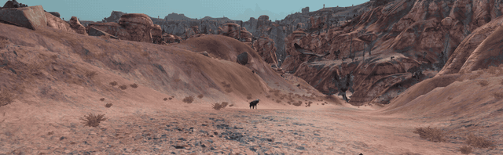

# PZA's Wildlife for Meitou

> **Version 0.2.0** (2026-11-23) · beta · code mod for [Meitou](https://github.com/VlcekM/MeitouClient) `>=0.20.1`
> (checked on 0.20.1, 0.21.0, 0.22.1 and the 0.22.2 nightlies of 2026-11-22) · author: PZA · GPLv3

**Birds come to carrion.** When something dies, the birds flying nearby notice. They circle high over the body, spiral down, land
beside it with their wings folded and peck at it. When anyone comes within about 20 m, they burst up, steeply and away from them, and
the whole flock scatters. If the body is still there later, they come back.

*Headless Meitou 0.22.1, no post-processing. Top: sped up. Bottom: real time.*

## What it does

- **Carrion draws birds.** A fresh kill pulls birds from up to 3 km away, at most 6 on one body. An old body (four game hours, or once it
  has flies) pulls from 1 km, at most 2.
- **They wait for you to leave.** While anyone stands within about 35 m of the body, the birds circle overhead instead of landing.
- **Landing and pecking.** A bird glides in, folds its wings and lands a wingspan away from the body and from other birds, then dips its
  head, hops (wings flicking half open) and turns. After a while it has eaten and flies off on its own.
- **Flight.** Anyone (player or not, as long as they are conscious) within about 20 m of a landed or low bird makes the birds at that
  body burst up, each its own way. They stay away for 25-50 seconds.
- **One ready-made look, nothing to tune.** Settings > Mods > PZA's Wildlife > *Birds at carrion* switches it on or off.
- English, Russian, Chinese and Japanese (the translations are machine-drafted; corrections are welcome).

## What it doesn't touch

Meitou's birds are drawn only: they are not part of the simulation, the AI or the save. This mod changes how some of them fly and how
landed ones are drawn, and nothing else. It writes nothing to your saves, so you can add or remove it at any time. Turning it off hands
every bird back to the game at once.

The folded wings are made in memory from the game's own bird model each time the game starts; no game file is copied, changed or
shipped. On a Meitou build where the mod can't do that, landed birds keep their wings spread and everything else still works.

## Install

Put the `PZAWildlife` folder in Kenshi's `mods` folder and enable *PZAWildlife* in the Meitou launcher's mod list.

## Build

Clone [PZA's Meitou UI](https://github.com/Meitou-Modding-Ecosystem/PZAMeitouUi) next to this repo (the mod compiles in its string
table; its fuzz kit runs the tests), unpack a Meitou release (win-x64), and name it in `mod/local.props` (git-ignored):

    <Project><PropertyGroup><MeitouDir>C:\path\to\Meitou-0.20.1-win-x64</MeitouDir></PropertyGroup></Project>

Then:

    mod\build.ps1                build against that release and stage mod\out\PZAWildlife\
    mod\build.ps1 -Check         plus the offline check and the fuzzer (never starts the game)
    mod\build.ps1 -Check -RunOn <another Meitou release>    the same build checked on another release

The offline check reads `birdtype1.mesh` from your Kenshi install (`-KenshiDir`, read only). It covers the rules case by case, the
folded-wing mesh, and the five Harmony patches applied to the real `MeitouClient.dll` with Meitou's own bird flocks flying over a test
terrain. Mutation check: `python -I ..\PZAMeitouUi\fuzz\mutate.py PZAMeitouWildlife` (12 planted bugs; all must be caught).

## How it works

All patches are on Meitou's own bird code (`Meitou.Game.Effects`, drawing side only):

- `Birds.UpdateAttractors` (postfix): copies the bodies and the living people from the world snapshot.
- `BirdFlocks.Update` (prefix): lets free birds be taken by a body.
- `BirdFlocks.Step` (prefix): moves a taken bird by the rules in `mod/src/WildCore.cs` instead of the game's step.
- `BirdFlocks.AddPieces` (postfix) and `DebrisRenderer.Load` (prefix): draw landed birds with the folded-wing model
  (`mod/src/BirdFold.cs`).

A taken bird is marked as circling an attractor, so the game's flocking leaves it alone, and it goes back to wandering when it is done.
Every rule counts each time it fires, and the log shows the counts every few seconds.

## Ideas and pull requests

If anyone has ideas to expand on this please submit PRs. There is a lot more to explore here.

Where to start: the rules (who takes which bird, landing, pecking, fleeing) are in `mod/src/WildCore.cs` with every number in one
`Preset`; the folded-wing model is `mod/src/BirdFold.cs`. A new rule comes with a case in `mod/tools/check`, a fuzz invariant in
`tests/fuzz/Program.cs` and a planted bug in `tests/fuzz/mutants.txt`.

## Licence

GPLv3 or later (`LICENSE`). Author: PZA. Unofficial fan-made mod; not affiliated with Lo-Fi Games or the Meitou project. See `NOTICE.md`.
